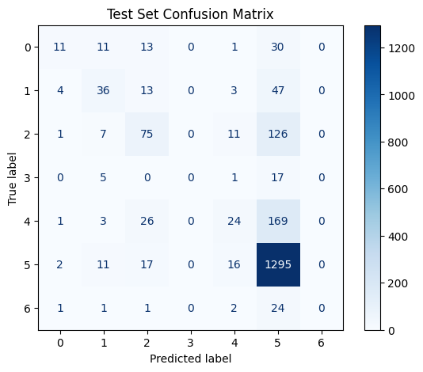

# DermaTriage AI: an educational skin lesion triage tool for patients waiting on dermatologists

**Track:** AI + Health · **Team:** Leen Bakri

*This project is an educational prototype and is not medical advice or a diagnostic tool.*

## The problem
Many patients—especially those in underserved areas or facing long specialist waitlists—delay getting suspicious skin spots checked because they cannot easily tell whether a lesion needs urgent attention. Everyday patients need a quick, accessible educational screening tool to help them understand visual skin patterns and decide when to prioritize a dermatologist appointment.

## What we built
DermaTriage AI takes a single close-up photo of a skin lesion along with two clinical ABCDE symptom questions (whether the spot is evolving in size/color or bleeding/itching) and returns either **🟢 ROUTINE: Monitor & Mention at Next Checkup** or **🔴 PRIORITY: Schedule a Dermatologist Visit Soon**, paired with the top visual match and confidence score:

> **Triage Recommendation:** 🔴 PRIORITY: Schedule a Dermatologist Visit Soon  
> Flagged due to either a higher-risk visual pattern or active ABCDE warning symptoms.  
> **Top Visual Match:** melanocytic nevi (86.0% confidence)  
> ⚠️ *Medical Disclaimer: This is an educational hackathon prototype, not a medical diagnosis.*

It runs in Google Colab with a live Gradio web app where users upload a photo, check symptom boxes, and click Submit.

## What we added
Standard skin-lesion tutorials only output a disease label, which is unsafe when a classifier misses high-risk cancers. We added three custom layers:
1. **Clinical ABCDE Symptom Override:** Combines computer vision predictions with human-in-the-loop symptom checkboxes (`Evolving` and `Bleeding/Itching`) so high-risk symptoms trigger a Priority Dermatologist Visit even if the visual pattern looks benign.
2. **High-Risk Safety Audit:** Specifically measured missed high-risk cancers (`melanoma`, `basal cell carcinoma`, `actinic keratoses`) versus false alarms across 2,005 unseen test images.
3. **Pixel-Luminance Fairness Audit:** Masked out the center lesion (`[5:23, 5:23]`) to measure surrounding skin brightness and check accuracy across higher-brightness and lower-brightness groups.

## How it works
* **Data:** 9,012 total dermatoscopic RGB images (28×28 pixels) across 7 skin lesion classes from **DermaMNIST** (MedMNIST v2). We used the official pre-split training set (7,007 images) and held-out test set (2,005 images) so no test data leaked into training.
* **Model:** Random Forest Classifier (100 decision trees) in `scikit-learn`, benchmarked against a majority-class `DummyClassifier` baseline.
* **Triage Logic:** Flags a lesion as **🔴 PRIORITY** if the top visual prediction falls into a high-risk class (`0`, `1`, or `4`) *or* if the user reports evolving size/color or bleeding/itching.

## Results

| Model / Evaluation Split | Test Set Accuracy (2,005 images) | High-Risk Lesions Caught (out of 392) | Missed High-Risk Cases (False Negatives) | False Alarms (False Positives) |
| :--- | :--- | :--- | :--- | :--- |
| **Baseline:** always predict common mole (`melanocytic nevi`) | 66.88% | 0 / 392 | 392 | 0 |
| **Random Forest Classifier (Final Model)** | **71.87%** (+4.99%) | **94 / 392** | **298** | **58** |

Our biggest finding is that a model can improve overall accuracy to nearly 72% and still miss most high-risk cancers when relying on low-resolution images alone.

**Where it fails:** Because benign common moles (`melanocytic nevi`) make up ~67% of `DermaMNIST`, our Random Forest still misclassifies 298 out of 392 high-risk lesions as common moles—proving why our manual ABCDE symptom checkboxes are essential as a safety override. Additionally, `DermaMNIST` strips patient `age` and `sex` metadata and lacks clinical Fitzpatrick skin-tone labels. In our pixel-luminance audit of surrounding healthy skin border pixels, accuracy was **70.89%** on higher-brightness images (`n=1,003`) versus **72.85%** on lower-brightness images (`n=1,002`), showing a **1.97% performance gap**, though true demographic skin-tone parity cannot be confirmed without clinically balanced skin-tone datasets.

## What we'd do next
* Train on clinically diverse skin-tone datasets (such as Fitzpatrick17k) and link the raw HAM10000 `age` and `sex` metadata to audit demographic fairness across all groups.
* Test class-balanced weights (`class_weight="balanced"`) and higher-resolution Convolutional Neural Networks (CNNs) to reduce missed high-risk cancers.
* Add Grad-CAM visual heatmaps so users can see which border or color regions influenced the model's prediction.

## Sources
* [MedMNIST v2 / DermaMNIST](https://medmnist.com), Yang et al. (2023), loaded via the official `medmnist` Python package.
* `scikit-learn`, `Gradio`, `NumPy`, `Matplotlib`, and `Pillow`.
* **AI tools:** Google Gemini, used as a coding and debugging assistant to structure the Python/Gradio pipeline and error-analysis cells, whose logic we reviewed and tested in Google Colab.
